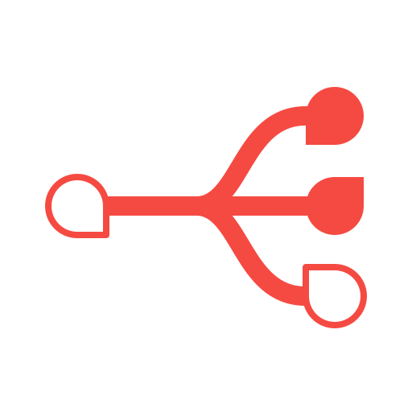

# productiveHub AI Gateway

An MIT-licensed AI gateway over [`@productivehub/ai-bridge`](./packages/bridge/README.md): one HTTP
endpoint for every configured model provider, with named accounts, model aliases and a CLI,
created and maintained by [Segev Shmueli](https://github.com/segevsh) for
[productiveHub](https://github.com/productivehub).

| Package | Folder | What |
| --- | --- | --- |
| [`@productivehub/ai-bridge`](./packages/bridge/README.md) | `packages/bridge` | In-process library: one provider-neutral way to call AI model providers, with injected providers and typed response dialects |
| [`@productivehub/ai-gateway-api`](./packages/api/README.md) | `packages/api` | Mountable Hono HTTP API and standalone Node/Deno listener |
| [`@productivehub/ai-gateway-cli`](./packages/cli/README.md) | `packages/cli` | `ai-gateway` command: completions, model and account discovery, `serve` |

The packages share one config format (`GatewayConfig`) and one HTTP contract.
The CLI never calls the bridge directly; it sends HTTP requests to the API app
in-process, or to a running server with `--url`.

Completions support canonical chat and Jev evaluations, the intrinsic `structured`
response dialect, and `both`, `output`, or `raw` response modes. DeepSeek and
Ollama Cloud also expose remaining allowance. The standalone listener defaults
to loopback; caller authentication and project attribution belong to the host.
See the [HTTP contract](./packages/api/README.md#http-contract) and
[access policy](./packages/api/README.md#caller-authentication-and-project-attribution).

```sh
ai-gateway complete writer "Summarize this repo in one line"
ai-gateway serve --config ./gateway.config.json
```

## Repository layout

Each package lives in `packages/<name>` with its own `package.json`, `tsconfig.json`
(extending the shared `tsconfig.base.json`), `src/`, `test/`, `README.md` and
`LICENSE`. Packages depend on each other through `workspace:*` and TypeScript
project references.

The repository is a self-contained pnpm workspace: the api and cli link the
bridge (and the cli links the api) through `workspace:*`, which `pnpm publish`
replaces with the released version. Public npm publishing is configured but has
not been performed.

```sh
pnpm install
pnpm build        # bridge, then api, then cli
pnpm typecheck
pnpm test
```

It is also developed inside the [phub-director](https://github.com/productivehub)
workspace as a submodule; there, run `pnpm install` from the director root and
filter by package name (`pnpm -F @productivehub/ai-bridge test`).

See [CONTRIBUTING.md](./CONTRIBUTING.md), [AUTHORS.md](./AUTHORS.md), and [LICENSE](./LICENSE).
